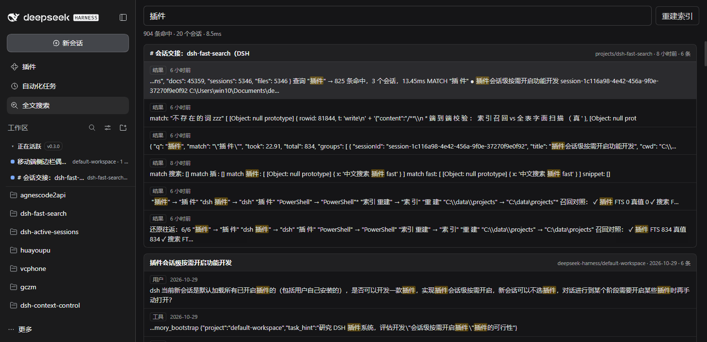

# dsh-fast-search

DSH Web 的**会话全文搜索**插件：自带 SQLite FTS5 索引，侧栏一个入口，输入后点「搜索」或回车检索，点结果直接跳进那个会话。查询支持 `且/或/括号` 自由组合，结果可以按工作区（项目）、消息类型（用户 / 助手 / 工具 / 结果 / 标题）和 `1 天 / 1 周 / 1 月` 或自定义日期时间窗筛选。

替代官方 `@deepseek-ai/dsh-experimental-session-search`——后者是内存版 MiniSearch，每次启动把 5,400 个会话日志**全量解压重建**，本机实测约 **9.7s**，且只活在进程内存里。本插件把这件事下沉成磁盘索引：首轮建库 36s，之后增量，单次查询 **2–25ms**。



## 实测数据（本机 5,409 个会话 / 49,355 条消息，2026-11-07）

索引会随会话增长，下面的命中数是当时的快照；延迟是稳定的。

| 项目 | 数值 |
|---|---|
| 全量建库（5,408 个 `.jsonl.zstd`） | **35.8s**，解压 2.9s / 解析 3.9s / 写 FTS 12.8s |
| 索引体积 | **94.9MB**（比原始日志 85.1MB 略大，含 FTS 倒排） |
| 查询 P50（`插件` / 885 条命中） | **13.9ms** |
| 查询 P50（`调音台` / 70 条命中） | **19.2ms** |
| 查询 P50（稀有词 / 1 条命中） | **1–3ms** |
| 增量对账（无变化） | 5,408 个文件 stat 后跳过，< 1s |

## 安装

运行要求：Node.js **22.13+**（插件直接用内置 `node:sqlite`，更早的版本没有这个模块；DSH 宿主本身要求 24.9+）。

### 从 GitHub Release 安装（推荐，支持在线升级）

```powershell
dsh plugin --profile web add `
  "https://github.com/zp96324511/dsh-fast-search/releases/latest/download/dsh-fast-search.tgz"
```

`dsh-fast-search.tgz` 是一个**不带版本号的稳定名**——`releases/latest/download/<name>` 只解析 `latest` 这个 tag，不会替你改文件名，所以同一条命令永远装最新版。要锁定版本就把 URL 换成带 tag 的那份：

```powershell
dsh plugin --profile web add `
  "https://github.com/zp96324511/dsh-fast-search/releases/download/v0.4.2/dsh-fast-search-0.4.2.tgz"
```

**装完（或升级完）需要手动重启一次 `dsh web`**：宿主侧代码不参与 HMR，重启前跑的仍是旧版本。之后就有升级通道了——面板状态行里、重建索引按钮后面的版本号平时只是版本号，有新版本时变成 `↑ vX.Y.Z`，点一下即可换到新版。插件只提示「请手动重启 dsh web」，不会替你操作宿主进程（宿主可能带自定义参数、端口或环境变量）。

### 开发态安装（改代码即时生效）

源码留在工作区，用目录联接挂进 profile：

```powershell
New-Item -ItemType Junction `
  -Path  "C:\Users\win10\.dsh\profiles\web\node_modules\dsh-fast-search" `
  -Target "C:\data\projects\dsh-fast-search"

# 在 profile 的 patch 里注册（追加到文件末尾）
'- insert:
    - id: fast-search
      name: dsh-fast-search' | Add-Content "C:\Users\win10\.dsh\profiles\web\cordis.patch.yml"
```

联接安装的副本是 `link:` 依赖，**不会**提示在线升级（就地升级会覆盖你的工作区），升级接口会明确回一条 `unchanneled`。

`cordis.patch.yml` **是热加载的**，改完不用重启宿主。但插件自己的宿主代码（`index.js` / `src/*.js` / `update.js`）不会热更，改这些要重启 `dsh web`；`client.js` 会随页面刷新重新拉取。

验证：

```powershell
(Invoke-RestMethod http://127.0.0.1:10550/plugin-api/dsh-fast-search/status) | ConvertTo-Json
(Invoke-RestMethod http://127.0.0.1:10550/plugin-api/dsh-fast-search/update) | ConvertTo-Json -Depth 4
```

卸载：`dsh plugin --profile web remove dsh-fast-search`（开发态则是删掉 patch 里那两行再 `Remove-Item` 那个联接，不要删工作区本身）。

## 使用

- 侧栏 **🔍 全文搜索**（在「正在活跃」下面），点开是独立面板。
- 输入过程中不发请求；点搜索框右侧的「搜索」按钮或按 `Enter` 检索。词没改时 `Enter` 打开第一条命中（改过词则先搜新词），`↑ ↓` 在命中间移动，`Esc` 清空。
- 结果按会话分组：会话标题 + 工作区 + 相对时间，每条命中带类型徽标（用户 / 助手 / 工具 / 结果 / 标题）和高亮片段。
- 搜索框上面一行是筛选：工作区下拉（带会话数）+ 消息类型芯片（全部 / 用户 / 助手 / 工具 / 结果 / 标题，可多选）
  + `全部 / 1 天 / 1 周 / 1 月` 快捷档 + 自定义起止日期；选择记在
  `localStorage`，刷新和重开面板都保持；切换后立即重跑当前查询。
- 点会话标题或任一命中 → 跳到该会话（`uiWorkspace.openSession`）。

### 查询语法

| 写法 | 含义 |
|---|---|
| `插件 缓存` | 空格分隔 = AND，两个词都要出现（**旧行为不变**） |
| `插件 且 缓存` / `插件 AND 缓存` | 显式 AND；也接受 `&`、`&&`、`＆` |
| `插件 或 缓存` / `插件 OR 缓存` | 显式 OR；也接受 `\|`、`\|\|`、`｜` |
| `(插件 OR 缓存) AND 索引` | 括号分组，优先级 `AND > OR`（本版没有 NOT） |
| `插件` | 中文按**字**建索引，双字词直接命中（内部是短语 `"插 件"`） |
| `mmap` | 纯 ASCII 且长度 ≥3 时，**最后一个词自动前缀匹配**，也命中 `mmap3` / `mmap_size`（仅纯词查询） |
| `mmap*` | 显式前缀（任何词都可以加 `*`；用了 `AND/OR/括号` 后前缀必须显式写） |
| `"node sqlite"` | 显式短语；`unicode61` 在 `_` 与 `-` 处切词，所以 `node_sqlite` 也能被它命中 |

运算符必须**用空格隔开**：`插件 或 缓存` 是三个 token，`插件或缓存` 会被当成一个词（这是为了能搜到
正文里的 `插件或缓存` 这种写法）。引号里的 `AND` / `OR` / `且` / `或` 也是普通词。
括号/运算符写错时不会搜不出东西：面板会提示语法错误，并退回「所有词同时命中」的旧行为。

### 筛选

| 筛选 | 行为 |
|---|---|
| 工作区 | 精确匹配会话的 `cwd`（Windows 盘符/路径大小写不敏感，末尾斜杠会被忽略）；下拉列表来自 `GET /workspaces`，按最近一条消息倒序 |
| 消息类型 | 按会话事件的 `type` 过滤：用户 `user/message`、助手 `assistant/message`、工具调用 `tool/call`、工具结果 `tool/result`、会话标题 `session/title`。芯片可多选（取并集），不选 = 全部类型 |
| `1 天 / 1 周 / 1 月` | 按**消息时间**过滤（不是会话创建时间），`1 月` 固定 30 天；时间窗由宿主按「现在」换算，所以放一晚上再打开仍是「近 1 天」 |
| 自定义日期 | 选择起止日期（本地时区，含首尾两天）；只填一端就是开放区间，和快捷档一样按消息时间过滤 |
| 组合 | 工作区、消息类型与时间窗可叠加；`total`、会话分组、语义召回都受同一组条件约束 |

筛选只影响结果，不改索引；切换筛选不需要重建库。

## 语义检索（可选）

全文索引是**唯一**的快路径；语义是叠加在旁边的第二条召回通道，用你自己的一台
OpenAI 兼容嵌入服务（默认按 bge-large 调参）把对话正文嵌进本地向量库。
不配 `vectors.url` 时，插件的行为与 0.2.x 逐字节一致。

- **按词找不到时补一轮。** 搜索框上方的「语义」下拉是查询开关：
  `auto`（默认）只在全文命中少于 `autoThreshold`（5）条时才跑向量召回，日常查询仍是 5–15ms；
  `on` 每次融合；`off` 完全不碰。选择记在 `localStorage`，跨刷新保持。
- **只补不替。** 两路结果用 RRF（k=60）按名次融合，全文命中原样保留，纯语义命中的条目带
  「语义」徽标——它没在正文里出现你输的词，这是正常的。
- **服务挂了就静默降级。** 连不上 / 超时 / 4xx 都退回纯全文，面板只多一行
  `semantic.reason = "error"`，搜索不会失败。
- **相关性门槛。** 实测 bge-large 对中文会话语料：相关查询 top 相似度 0.57–0.71，
  无关查询（「今天天气怎么样」）top 只有 0.25–0.26。所以 `minScore` 默认 0.45：
  **最佳分低于它就不召回**，单条再按 0.75×minScore 砍尾巴，避免把 60 条噪声当结果。
- **建库是后台慢活。** 硬件升级后实测：单路约 2,000 字符/秒，2 路并发约 3,900（4 路无增益、
  8 路 502），批大小 8→64 不影响总吞吐。所以默认 `batch: 8`、`concurrency: 1`，
  服务扛得住时建议 `concurrency: 2`。启动 8 秒后开始，30 分钟兜底一轮，进度与 ETA 看 `/vectors`。
- **同一段文本只嵌一次。** 块按内容哈希去重：向量存在 `vec_content`（每段文本一份），
  `vec_refs` 存每个会话文件里的位置。会话开头注入的 skill 清单、HiveMem 简报、fork 出来的历史
  几乎全是重复文本——实测约占 49% 的字符量，这部分现在零成本复用。
- **断点续跑。** 文件追加写盘后只有新内容要重新嵌入；老块的 rowid 会自动改指向。
  模型 / 维度 / 切块版本变了则旧向量整库作废，不混用两套距离。

一次完整的建库（数据库副本上实测）：

```powershell
# 先让全文索引对上账，再由后台补语义（不传 --chars 就是全量）
node cli.mjs vectors sync --db $env:USERPROFILE\.dsh\storages\fast-search.db `
  --embed-url http://127.0.0.1:10450/v1/embeddings --embed-key <key> --embed-model bge-large

# 手动限速跑一批：本次最多嵌 2 万字符，约 35 秒
node cli.mjs vectors sync --chars 20000 --embed-url http://127.0.0.1:10450/v1/embeddings --embed-key <key>

# 只查语义（全文 0 条也能出结果）
node cli.mjs search "让搜索更快一点的办法" --semantic on `
  --embed-url http://127.0.0.1:10450/v1/embeddings --embed-key <key>
```

设计取舍与运维细节见 [docs/semantic.md](docs/semantic.md)。

## 架构

```
~/.dsh/sessions/<workspace-slug>/<session-id>/session.v4.jsonl.zstd
        │  zstdDecompressSync + 逐行 JSON（type 预筛，只 parse 6 类事件）
        ▼
   decode.js ──► docs(text) ──► FTS5(unicode61, 建索引前逐字插空格)
        │                              │
        │                    两阶段查询：bm25 排序取 300 → 只对展示的 20 条取正文
        │                              │
        │                    （可选）chunk.js 切块 ──► embed.js ──► bge 服务
        │                              │                      │
        ▼                              ▼                      ▼
   store.js ◄────────────────── router.js ◄── search.js ◄── vectors.js
   (水位线/增量/int8 向量)          /status /search        (RRF 融合)  (内存点积)
                                   /reindex /vectors*          │
                                        │                     └── vec_content(hash) + vec_refs(path,hash)
                                        ▼
                                  HTTP(JSON) ──► client.js 面板
```

| 文件 | 职责 |
|---|---|
| `index.js` | Cordis 插件入口：起索引器与向量引擎、挂 HTTP 前缀路由（零外部依赖，连 Config schema 都不写） |
| `src/decode.js` | 日志解码：`user/message`、`assistant/message`(text)、`tool/call`、`tool/result`、`system/message`、`session/title` |
| `src/tokenize.js` | `cjkSpace`（建索引）/ `cjkUnspace`（还原）/ `compileQuery`（AND·OR·括号 → FTS5 MATCH，含语法错误降级） |
| `src/snippet.js` | 片段窗口 + 高亮，返回 `[{text, mark}]` 段数组（React 渲染，不拼 HTML） |
| `src/store.js` | FTS5 + 水位线表 + `vec_content`/`vec_refs`（老 `vec_chunks` 打开时自动迁移）；`replaceFile` 单事务先删后插；两阶段 `search()` 与工作区/时间筛选 |
| `src/indexer.js` | 全量对账（size+mtime 跳过）、`fs.watch` 增删、15 分钟兜底扫描 |
| `src/chunk.js` | 语义切块：480 字符/块，切点优先段落 > 换行 > 句末标点，块哈希用于去重 |
| `src/embed.js` | 嵌入客户端（OpenAI 兼容 `/v1/embeddings`）：批处理、退避重试、L2 归一化、int8 量化 |
| `src/vectors.js` | 向量引擎：建库对账（只嵌新块）、内存块状 int8 矩阵、暴力点积 top-k、状态与降级 |
| `src/search.js` | 混合检索：RRF 融合、按会话重组、`autoThreshold` 决策、异常降级 |
| `src/router.js` | JSON 路由，请求体上限 256KB；`/search` 筛选归一化、`/workspaces` 列表；`/update*` 交给升级路由先认领 |
| `update.js` | 升级通道：判断 came-from（Release / registry / 本地）、版本比较、跑 `dsh plugin add`；只提示手动重启，不操作宿主 |
| `client.js` | 浏览器半边：侧栏图标 + 主面板 + 筛选/语义下拉 + 版本号入口，只用 `require('react')` |
| `scripts/check-manifest.mjs` | 发布前自检：清单里写的每个文件必须真的存在 |
| `scripts/make-channel.mjs` | 由打包产物算出 `channel.json`（版本、大小、sha256） |

### HTTP API

前缀 `/plugin-api/dsh-fast-search`（刻意避开 `/plugins/`——那是 client bundle 的领地，按最长前缀会被抢走）。

| 路由 | 说明 |
|---|---|
| `GET /status` | `{ version, sessionsDir, dbPath, dbBytes, docs, sessions, files, searchMode, index: { phase, done, total, indexed, skipped, removed, lastError }, vectors: { enabled, ready, paused, model, dim, batch, concurrency, chunks, contents, bytes, docsCovered, docsTotal, progress: { phase, chunks, chunksTotal, chars, charsTotal, embedded, reused, rate, etaMs }, lastError } }` |
| `GET /workspaces` | `{ workspaces: [{ cwd, sessions, docs, updatedAt }] }`，按 `updatedAt`（该工作区最近一条消息）倒序 |
| `GET\|POST /search` | 入参 `q`（必填）、`limit`（≤300）、`groupLimit`、`perSession`、`includeTotal`、`semantic`（`off`/`auto`/`on`，也接受 `true`/`false`）；筛选 `workspace`（cwd 原值）、`kinds`（消息类型数组或逗号分隔字符串，也接受单值别名 `kind`；值可用事件全名或短名 `user`/`assistant`/`tool`/`result`/`title`）、`since`/`until`（毫秒或 ISO 日期）、`range`（`1d`/`1w`/`1m`，也接受 `day`/`week`/`month` 等别名） |
| `POST /reindex` | 触发全量对账（`force=true` 时整库重建），异步，进度看 `/status` |
| `GET /vectors` | 语义索引状态（同 `/status` 里的 `vectors`） |
| `POST /vectors/sync` | 触发一轮建库，`{ force, maxChars }`，202 立即返回；进度看 `/vectors` |
| `POST /vectors/pause` | `{ paused: true\|false }`，暂停/恢复后台建库（不清数据） |
| `GET /ping` | `{ ok: true, version, package }`，健康检查 |
| `GET /update` | 查最新版本；`?force=1` 跳过 6 小时缓存。返回 `{ ok, current, latest, hasUpdate, canUpgrade, channel:{kind,…}, installSpec, compatible, stale, restartRequired, upgrading, error }` |
| `GET /update/job` | 升级作业状态 `{ state: idle\|running\|done\|failed, phase, from, to, log, error }` |
| `POST /update/upgrade` | 起一次升级（`{version}` 可指定）。`ok:false` 时看 `reason`：`up-to-date` / `unchanneled` / `busy` / `no-launcher` … |

`/search` 返回：

```json
{ "q": "插件 OR 缓存", "match": "\"插 件\" OR \"缓 存\"", "terms": ["插件", "缓存"],
  "words": ["插件", "缓存"], "syntax": "boolean", "parseError": null,
  "filters": { "workspace": "C:\\data\\projects\\dsh-fast-search", "kinds": ["user/message", "tool/result"],
               "since": 1793…, "until": null, "range": "1w" },
  "took": 16.1, "total": 872, "truncated": true,
  "groups": [{ "sessionId": "session-…", "title": "…", "cwd": "…", "createdAt": 1793…,
               "lastTime": 1793…,
               "docs": [{ "seq": 42, "kind": "assistant/message", "role": "assistant", "time": 1793…,
                          "snippet": [{ "text": "这个", "mark": false }, { "text": "插件", "mark": true }],
                          "matched": 2, "source": "fts", "score": 0.0164 }] }],
  "semantic": { "used": true, "mode": "auto", "model": "bge-large", "hits": 42, "shown": 3,
                "topScore": 0.571, "ms": 201 } }
```

`docs[].source` 是 `fts` / `vec` / `both`；`vec` 条目额外带 `similarity`（余弦）。
`semantic.used=false` 时看 `reason`：`off` / `disabled` / `enough-fts` / `no-match`（低于 `minScore`）/ `error`。
`syntax` 是 `legacy`（纯词/短语，旧行为）/ `boolean`（含运算符或括号）/ `fallback`（语法错误已降级）/ `empty`。
`parseError` 非空时值为 `unbalanced-paren` / `empty-group` / `missing-operand` / `unexpected-close` / `unexpected-token`。

### 配置

写在 patch 的条目上即可（都有默认值）：

```yaml
- insert:
    - id: fast-search
      name: dsh-fast-search
      config:
        sessionsDir: C:\Users\win10\.dsh\sessions
        dbPath: C:\Users\win10\.dsh\storages\fast-search.db
        cap: 8192          # 单条消息进索引的最大字符数
        bootDelayMs: 3000  # 宿主启动后延迟多久开始对账
        sweepMs: 900000    # 兜底全量对账间隔
        watch: true        # fs.watch 增量
        update:
          github: zp96324511/dsh-fast-search   # 留空则从安装 spec 自己推断
          checkIntervalMs: 21600000            # 6 小时
        search:
          mode: auto                           # 面板默认模式：off | auto | on
        vectors:                               # 不填 = 关闭语义检索
          enabled: true
          url: http://127.0.0.1:10450/v1/embeddings
          apiKey: bge.zpzp.xyz                 # 会以 Bearer 头发出去；留空则不带鉴权
          model: bge-large
          dim: 1024                            # 服务端上报的维度优先，对不上会整库重建
          kinds: [user/message, assistant/message, session/title]
          chunkChars: 480                      # bge 的 512 token 上限，留一点余量
          chunkOverlap: 64
          batch: 8                             # 单请求文本数；实测与总吞吐无关，小批只为进度平滑
          concurrency: 2                       # 并发请求数；实测 2 路 ≈1.9×，4 路无增益、8 路 502
          autoThreshold: 5                     # 全文命中 < 5 条才自动补语义
          topK: 60
          minScore: 0.45                       # 最佳分低于它整体不召回；0 = 关掉门控
          maxCharsPerMinute: 0                 # 0 = 不限速
          sweepMs: 1800000                     # 30 分钟兜底对账
```

`apiKey` 等价于明文密码，写在 patch 里就要保证那个文件只有你自己能读。

不写 `sessionsDir` / `dbPath` 时，落点跟着 DSH 的数据根走：`$DSH_HOME`（未设置则 `~/.dsh`）
下的 `sessions/` 与 `storages/fast-search.db`，与 DSH 自己的 `resolveDshHome` 同口径。
`DSH_HOME` 不在用户目录的机器（例如 Windows 上 `D:\DeepSeekHarness\data`）不要手动指到
`~/.dsh`——那里可能只是一份更早的旧 home，索引它会让面板只剩几个旧项目。

## 在线升级

升级通道分三步，任何一步失败都只影响那一步：

1. **判断这一份是从哪装的。** 读 profile 的 `package.json` 里那条依赖：Release 的 tarball URL → 问 GitHub；`^0.2.0` / `latest` → 问 npm registry；`link:` / `file:` / git spec → **不提供**在线升级（就地升级会覆盖本地 checkout，接口会明确回 `unchanneled`）。
2. **问最新版本。** 主路径是 `https://github.com/<owner>/<repo>/releases/latest/download/channel.json`——它跟着 release 的 `latest` 标签走，且不吃 GitHub API 的限流；拿不到就退回 `api.github.com/repos/.../releases/latest`。答案缓存 6 小时。
3. **装，然后由用户手动重启。** 升级就是跑一遍 `dsh plugin --profile <name> add <spec>`（和用户手敲完全同一条命令），锁文件、失败回滚、兼容性闸门都由它负责；装完用 `node_modules/<pkg>/package.json` 的真实版本对账（pnpm 的供应链延迟策略会让你以为装上了新版）。宿主侧代码不会热更，所以装完只是磁盘换了版本，面板会提示「请手动重启 dsh web」。**插件不替你重启宿主**：启动参数、端口、环境变量可能由外部编排决定，插件无权也不该替用户重新拉起进程。

面板上的升级交互只有两处：版本号（点它强制检查，有新版本时变成 `↑ vX.Y.Z`）和升级按钮。后台静默检查失败不会弹红字——离线机器不该顶着一条错误。

### 发一个新版本

```powershell
# 1. 改 package.json 的 version + CHANGELOG 里加一节
# 2. 本地自检
npm run check
# 3. 提交并打 tag（tag 必须等于 version，publish.yml 会校验）
git add -A; git commit -m "release 0.4.2"; git tag v0.4.2
git push origin main --tags
```

`publish.yml` 会跑自检、`npm pack`、生成 `channel.json`（版本 / 大小 / sha256）、建 release 并上传三个资产：`dsh-fast-search-<version>.tgz`、稳定名 `dsh-fast-search.tgz`、`channel.json`。配置了 `NPM_TOKEN` 时会额外 `npm publish`，没配就跳过。

## 命令行（不装宿主也能用）

```powershell
node cli.mjs build  --db .tmp\test.db --sessions C:\Users\win10\.dsh\sessions --force
node cli.mjs search --db .tmp\test.db "插件" --limit 10
node cli.mjs search --db .tmp\test.db "插件 OR 缓存" --workspace "C:\data\projects\dsh-fast-search" --range 1w
node cli.mjs search --db .tmp\test.db "插件" --kind user,assistant --limit 10
node cli.mjs search --db .tmp\test.db "工具" --kind tool,result --json
node cli.mjs search --db .tmp\test.db "让搜索更快" --semantic on --embed-url http://127.0.0.1:10450/v1/embeddings
node cli.mjs vectors status --db .tmp\test.db --embed-url http://127.0.0.1:10450/v1/embeddings
node cli.mjs vectors sync   --db .tmp\test.db --chars 20000 --embed-url http://127.0.0.1:10450/v1/embeddings
node cli.mjs status --db .tmp\test.db
```

嵌入服务的地址/密钥也可以用环境变量：`DSH_EMBED_URL`、`DSH_EMBED_KEY`、`DSH_EMBED_MODEL`。

## 测试

```powershell
npm run check                # 清单自检 + 语法 + 五个冒烟测试（CI 跑的就是它）
node test\update-smoke.mjs   # 升级通道：通道分类、版本比较、HTTP 语义、本地副本拒绝升级
node test\client-smoke.mjs   # 不装宿主：工厂 → apply → 槽注册 → 筛选行 → 渲染（自带 React 桩）
node test\vectors-smoke.mjs  # 语义链路：切块不变量、跨词召回、融合、重启免重建、增量、换模型作废
node test\query-smoke.mjs    # 查询语法 + 工作区/时间/消息类型筛选：真 FTS 库上的 17 组语法与 16 组筛选断言
node test\http-smoke.mjs     # 真 HTTP：/status、/search 筛选（工作区/时间/类型）与语义、/workspaces、/vectors*、409
node test\verify.mjs         # 建库 + 召回真值对照（FTS 计数 vs 全表字面扫描）+ 往返一致性
node bench\cdp-verify.mjs 9222 插件   # 真浏览器端到端：bundle 加载、点图标、搜出结果、截图
node bench\cdp-click.mjs   9222      # 点结果跳会话 + 回来恢复上次查询
```

`bench/` 里还有 P0 基准脚本（分词方案对比、查询分解、逐阶段剖析），结论写在 `docs/p0-baseline.md`。

## 已知限制

- **只索引 `text` 片段**。`reasoning`（27.5MB，占正文 40%）不进索引——它是模型的思考草稿，噪声远大于价值。要打开就改 `decode.js` 里的 `joinParts`。
- **系统提示词默认不入索引**。每个会话的 `system/message` 都是同一份模板，进索引会让「工具」「插件」「agent」这类词被几百份样板文本淹没。
- **面板与主视图互斥**：点结果会切到会话视图，面板被卸载；回来时会自动重跑上次的查询（结果和耗时都是新的）。
- **首查可能慢一拍**：宿主刚重启、OS 页缓存冷时，第一次查询约 300ms，之后稳定在 20ms 内。
- **只搜已落盘的会话**：日志由宿主追加写入，`fs.watch` 250ms 防抖后会补进索引，正在进行的会话可能有几百毫秒延迟。
- **布尔语法没有 NOT**：本版只做 `AND` / `OR` / 括号；运算符必须空格隔开，`插件或缓存` 是一个词而不是 OR。
- **筛选是精确工作区**：`workspace` 按 `sessions.cwd` 原值匹配（不递归子目录）；时间筛选按消息 `time`，缺少时间的历史文档在 `since` 下会被排除。
- **筛选不进语义索引**：语义召回在打分阶段按筛选后的 rowid 候选过滤，不会跨工作区/时间段/消息类型召回；这不需要重建向量库。
- **语义索引默认只嵌三类消息**：`vectors.kinds` 默认 `user/message, assistant/message, session/title`；
  只筛「工具 / 结果」时全文照常命中，但那两类块没有向量，语义补召为空。
- **升级必须手动重启一次**：宿主侧代码（`index.js` / `src/*.js` / `update.js`）不参与 HMR；面板只提示，不提供也不执行宿主重启。
- **语义模式比全文慢一个数量级**：每次要等嵌入服务回一个查询向量，实测 60–210ms（冷查询更久），
  所以它不进快路径，`auto` 也只在全文稀疏时才触发。
- **语义索引只能补不能救**：没建完的会话只按已嵌入的部分召回；`/vectors` 的
  `docsCovered / docsTotal` 就是这个覆盖率，缺的靠后台轮次慢慢补。
- **切块是字符级的**：480 字符按标点和换行切，不按 token 精确计数；极端情况下
  （无标点长串）会硬切并带 64 字重叠，语义上略冗余但不会丢内容。

## 故障排查

| 现象 | 原因 / 处理 |
|---|---|
| 侧栏没有图标 | profile 的 patch 没生效：`GET /plugin-api/dsh-fast-search/status` 若 200 说明宿主已加载，浏览器硬刷新（`Ctrl+Shift+R`）即可 |
| `/plugin-api/...` 404 | patch 里 `id`/`name` 写错，或联接没建好（`Test-Path …\node_modules\dsh-fast-search\index.js`） |
| `lastError: database is locked` | 两个进程同时写库（比如 CLI 建库时宿主也在对账）。已设 `busy_timeout=5000`，重启宿主后自愈 |
| 磁盘上出现几十 MB 的 `fast-search.db-wal` | 大写入后的 WAL 尾巴，收尾时自动 `wal_checkpoint(TRUNCATE)`；也可以手动 `PRAGMA wal_checkpoint(TRUNCATE)` |
| 索引明显落后 | `POST /reindex` 触发对账，盯着 `/status` 的 `index.done/total` |
| 语义下拉禁用、显示「关」 | 宿主没配 `vectors.url`（或 `enabled: false`）：`GET /vectors` 里 `enabled:false` 就是这个原因 |
| `semantic.reason = "error"` | 嵌入服务连不上/超时/4xx：搜索会自动退回纯全文；`GET /vectors` 的 `lastError` 有原文 |
| 语义召回一条都没有 | 先看 `docsCovered` 是不是 0（还没建库），再看 `topScore`：低于 `minScore`（0.45）时按设计不召回 |
| 建库几小时还没完 | 正常。单路约 2,000 字符/秒（`concurrency: 2` 约 3,900）；`POST /vectors/pause` 可随时停，数据不丢，下次续跑 |
| 换了嵌入模型/维度 | 旧向量会自动作废（日志里写「向量索引作废」），需要重新建一轮 |

## 变更记录

见 [CHANGELOG.md](CHANGELOG.md)。最近一次：**0.5.0** — 新增「消息类型」筛选（用户 / 助手 / 工具 / 结果 / 标题，可多选），索引结构不变。
